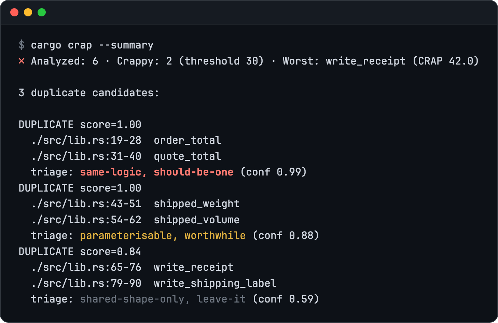

# cargo-crap

<p align="center">
  <a href="https://crates.io/crates/cargo-crap"></a>
  <a href="https://github.com/minikin/cargo-crap/actions/workflows/ci.yml"></a>
  <a href="https://github.com/minikin/cargo-crap/actions/workflows/ci.yml"></a>
  <a href="docs/guides/badge.md"></a>
  <a href="LICENSE"></a>
</p>

<p align="center">
  <picture>
    <source media="(prefers-color-scheme: dark)" srcset="https://raw.githubusercontent.com/minikin/cargo-crap/main/docs/assets/hero-dark.webp">
    
  </picture>
</p>

<p>
  <a href="https://minikin.me/blog/cargo-crap"><picture><source media="(prefers-color-scheme: dark)" srcset="https://github.com/minikin/cargo-crap/raw/HEAD/docs/assets/link-blog-untested-complexity-dark.svg?sanitize=true"></picture></a>
  <a href="https://minikin.me/blog/cargo-crap-triage"><picture><source media="(prefers-color-scheme: dark)" srcset="https://github.com/minikin/cargo-crap/raw/HEAD/docs/assets/link-blog-triaging-duplicates-dark.svg?sanitize=true"></picture></a>
  <a href="https://www.youtube.com/watch?v=XuMR1pgc6pc"><picture><source media="(prefers-color-scheme: dark)" srcset="https://github.com/minikin/cargo-crap/raw/HEAD/docs/assets/link-talk-youtube-dark.svg?sanitize=true"></picture></a>
</p>

cargo-crap finds the Rust functions that are both complex and untested: the
ones where a change is most likely to break something without a test
failing. It parses your source with `syn`, reads the LCOV file your coverage
tool already writes, and gives every function a CRAP score. Run it locally to
see where tests are missing, or in CI to fail a build when a score crosses
the threshold or goes up.

```text
CRAP(m) = comp(m)² × (1 − cov(m)/100)³ + comp(m)
```

`comp` is the function's cyclomatic complexity (CC) and `cov` its line
coverage in percent. A function with CC 12 and no tests scores 156. Cover
every line and it scores 12, its complexity. Savoia and Evans introduced the
metric in 2007. [The CRAP metric](docs/explanation/crap-metric.md) covers the
formula's properties and history.

## Install

```bash
cargo binstall cargo-crap          # pre-built binary
cargo install cargo-crap --locked  # from source, Rust 1.88 or newer
```

On Arch Linux, `paru -S cargo-crap`. [Install](docs/install.md) has the
download commands for the release archives on Linux and macOS, and the
Windows steps.

## Quick start

cargo-crap does not run your tests. It reads the LCOV file a coverage tool
writes, usually `cargo-llvm-cov` (`cargo tarpaulin` works too):

```bash
cargo install cargo-llvm-cov
cargo llvm-cov --lcov --output-path lcov.info
cargo crap --lcov lcov.info
```

<!-- output: --lcov lcov.info -->
```text
┌───┬───────┬────┬───────────────────┬──────────┬─────────────────┐
│   ┆  CRAP ┆ CC ┆ Coverage          ┆ Function ┆ Location        │
╞═══╪═══════╪════╪═══════════════════╪══════════╪═════════════════╡
│ ✗ ┆ 156.0 ┆ 12 ┆ ░░░░░░░░░░   0.0% ┆ crappy   ┆ ./src/lib.rs:24 │
├╌╌╌┼╌╌╌╌╌╌╌┼╌╌╌╌┼╌╌╌╌╌╌╌╌╌╌╌╌╌╌╌╌╌╌╌┼╌╌╌╌╌╌╌╌╌╌┼╌╌╌╌╌╌╌╌╌╌╌╌╌╌╌╌╌┤
│ ✓ ┆   6.7 ┆  4 ┆ ████░░░░░░  44.4% ┆ moderate ┆ ./src/lib.rs:12 │
├╌╌╌┼╌╌╌╌╌╌╌┼╌╌╌╌┼╌╌╌╌╌╌╌╌╌╌╌╌╌╌╌╌╌╌╌┼╌╌╌╌╌╌╌╌╌╌┼╌╌╌╌╌╌╌╌╌╌╌╌╌╌╌╌╌┤
│ ✓ ┆   1.0 ┆  1 ┆ ██████████ 100.0% ┆ trivial  ┆ ./src/lib.rs:8  │
└───┴───────┴────┴───────────────────┴──────────┴─────────────────┘
✗ 1/3 function(s) exceed CRAP threshold 30.
```

In a workspace, add `--workspace` to the `cargo llvm-cov` and `cargo crap`
commands. [Getting started](docs/getting-started.md) has more, including
`--summary` and `-p`.

## Reading the report

Rows are sorted worst first. `✗` marks a score above `--threshold`, `▲` a
score above a third of it, and `✓` everything else.

A score comes down two ways. Tests over the uncovered lines raise coverage
and pull CRAP down toward CC, and at 100% coverage the two are equal.
Splitting the function lowers CC itself. CRAP is never below CC, so a
function whose CC is above the threshold stays `✗` however well it is
tested: only a lower CC helps, which usually means splitting it.

To see which lines to test, set `uncovered-hints = true` in
`.cargo-crap.toml`. The human, markdown and pr-comment tables then gain an
Uncovered column with each function's uncovered line ranges: `26–56` for
`crappy` above.

Test code is not scored. `#[test]` functions and `#[cfg(test)]` modules are
skipped, and `tests/**`, `benches/**` and `examples/**` are excluded by
default. [What gets a score](docs/reference/complexity.md) lists what counts as a
branch.

## Add it to CI

On GitHub, one step does it, since 0.8.0:

```yaml
# .github/workflows/crap.yml
name: CRAP

on:
  push:
    branches: [main]
  pull_request:

permissions:
  contents: read
  pull-requests: write

jobs:
  crap:
    runs-on: ubuntu-latest
    steps:
      - uses: actions/checkout@v6
      - uses: minikin/cargo-crap@v1
```

On a pull request it scores the base commit in the same job, posts the
delta as a comment, and fails when a function's score rose. On a push it
writes the report to the job summary. See [GitHub Action](docs/guides/github-action.md)
for its inputs, and [#119](https://github.com/minikin/cargo-crap/pull/119)
for it live on the hero's demo crate, duplicates triaged by OpenAI included.

Elsewhere, the exit code carries the verdict: 0 when no gate tripped, 1 when
`--fail-above` or `--fail-regression` tripped, 2 when the run itself failed
(see [Exit codes](docs/reference/exit-codes.md)).
[Integrating with CI](docs/guides/ci.md) shows the commands, the
[regression gate](docs/guides/regression-gate.md) compares against a saved
baseline, and SARIF upload for GitHub Code Scanning is there too.

## Duplicates, triaged

*Since 0.6.0. OpenAI as a provider since 0.7.0.*

`--duplicates` lists functions with the same structure, and it needs no
coverage. Functions that all resemble each other are one group, so thirty
copies are one finding, not 435 pairs. Structure alone cannot tell the same
logic written twice from two functions that only share a Rust idiom. With
triage on, a model from [TypeSafe](https://docs.typesafe.ai) (the default)
or the
[OpenAI Decisions API](https://developers.openai.com/api/docs/guides/decisions)
answers three questions about each pair or group, one request each: what
kind of duplication it is, whether it is worth merging, and whether a fix to
one side would be missed in the other. The kind and the verdict on merging
print under the pair, and `--format json` carries all three answers. A real
run over the three pairs of the triage demo, all high on structure:



By structure alone the three pairs look equally urgent. Triage says to merge
the first, give the second a parameter and leave the third, and on a colour
terminal the verdict is red, yellow or dim to match. You know which pairs are
worth your time before you open them.

Triage sends both function bodies to the provider you pick, so it stays off
until `.cargo-crap.toml` sets `[duplicates.triage] enabled = true` and that
provider's key (`TYPESAFE_API_KEY` or `OPENAI_API_KEY`) is in the
environment. The release binaries (`cargo binstall`
and the downloads) include it. From source, install with
`cargo install cargo-crap --features triage`. It never changes a score, the
order of the pairs or the exit code.
[Triaging duplicates](docs/guides/triage.md) has the details,
and [the triage demo](examples/triage-demo) has three pairs to try it on.

## Documentation

- Guides: [integrating with CI](docs/guides/ci.md), [the GitHub Action](docs/guides/github-action.md),
  [regression gate](docs/guides/regression-gate.md),
  [PR comment bot](docs/guides/pr-comment.md),
  [workspaces and changed-package CI](docs/guides/workspaces.md),
  [Shields.io badge](docs/guides/badge.md).
- [Finding duplicates](docs/guides/duplicates.md) and
  [triaging them](docs/guides/triage.md).
- Reference: [command line](docs/reference/cli.md),
  [configuration file](docs/reference/config.md),
  [output formats](docs/reference/output-formats.md),
  [JSON output schema](docs/reference/json.md),
  [exit codes](docs/reference/exit-codes.md),
  [what gets a score](docs/reference/complexity.md).
- How it works: [the CRAP metric](docs/explanation/crap-metric.md),
  [design](docs/explanation/how-it-works.md),
  [the path-matching problem](docs/explanation/path-matching.md).
- [Troubleshooting](docs/troubleshooting.md) starts with the usual cause of a
  table full of 0%.

## License

MIT. See the [LICENSE](LICENSE) file.
